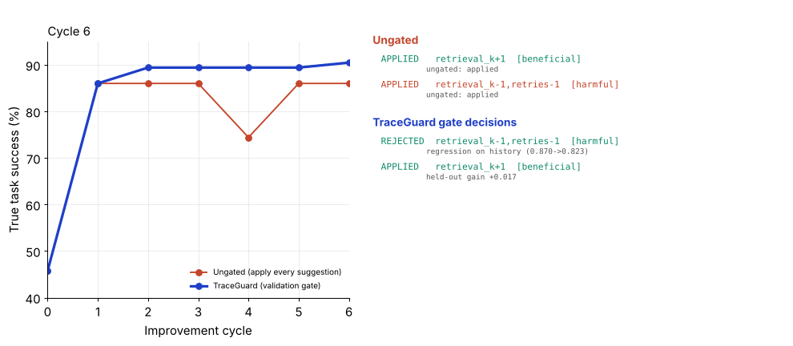
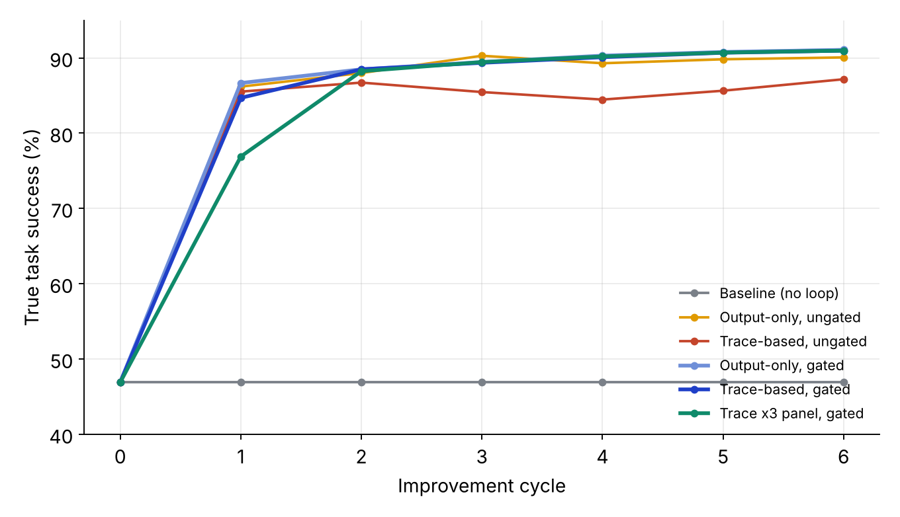
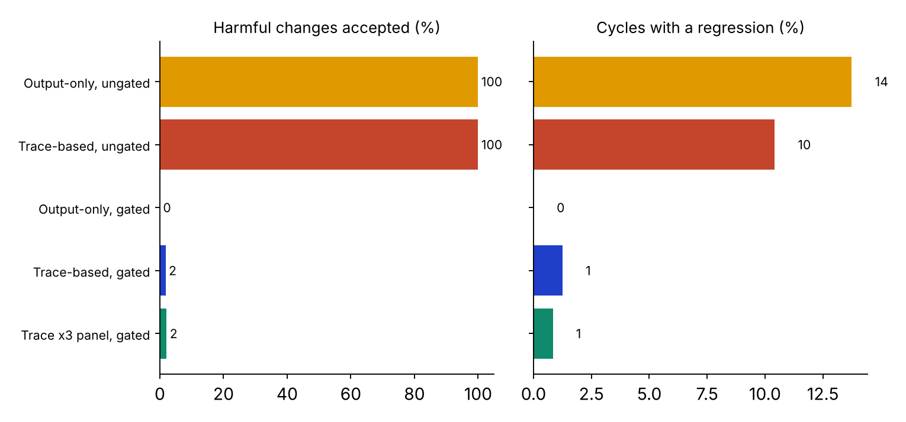
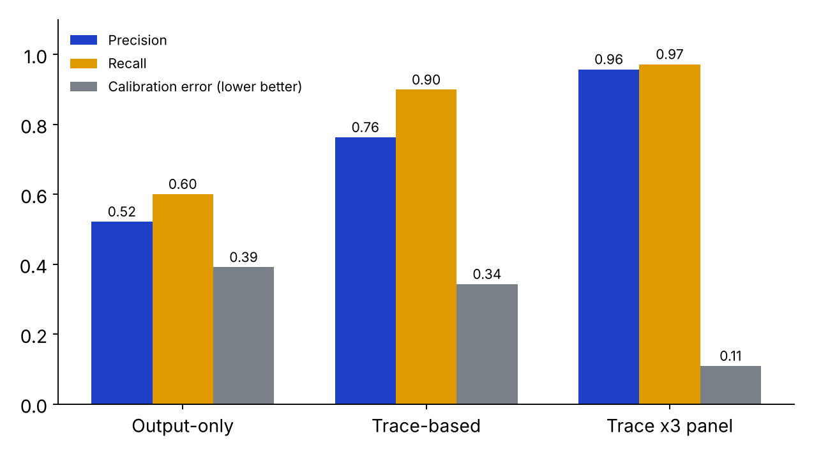

# TraceGuard

AI reviewing AI, with a gated improvement loop. Proof of concept for the L&T Techgium problem *AI Assisted Continuous Review and Performance Improvement of AI Agents*.

Reviewer models grade an agent's answers **and its traces** (plans, tool calls, retries). They never change the agent. Every suggested change must pass safety checks, a regression test on old tasks, a held-out test, a confidence threshold and a canary before it is promoted, and any version can be rolled back.



## Architecture

```
Target agent -> Trace recorder -> Reviewer panel -> Feedback store
                                                        |
Rollback <- Monitor <- Staged rollout <- Validation gate <- Improvement engine
```

| Component | File |
|---|---|
| Config-driven agent, trace recorder | `traceguard/agent.py` |
| Reviewers: output-only, trace-based, 3-reviewer panel | `traceguard/reviewers.py` |
| Feedback store, improvement engine, validation gate, canary | `traceguard/loop.py` |
| Experiments and metrics | `traceguard/experiments.py` |
| Figures and demo GIF | `traceguard/plots.py` |

## Run

```
pip install matplotlib numpy pillow pytest
python -m traceguard.experiments 40   # about 45 s, reproducible across runs, writes results/results.json
python -m traceguard.plots            # figures and demo.gif
python -m pytest -q tests
```

## Results (40 seeds, 6 cycles x 200 traces, true success on a separate 1,500-task set)

| Policy | Final success % | Harmful changes accepted % | Cycles with regression % | Reviewer precision / recall | Calibration error |
|---|---|---|---|---|---|
| Baseline (no loop) | 46.9 | n/a | n/a | n/a | n/a |
| Output-only, ungated | 90.1 | 100 | 14 | 0.53 / 0.60 | 0.38 |
| Trace-based, ungated | 87.2 | 100 | 10 | 0.79 / 0.90 | 0.29 |
| Output-only, gated | 91.1 | 0 | 0 | 0.52 / 0.60 | 0.39 |
| Trace-based, gated | 91.0 | 2 | 1 | 0.76 / 0.90 | 0.34 |
| Trace x3 panel, gated | 91.0 | 2 | 1 | 0.96 / 0.97 | 0.11 |





Findings:
- The gate's main benefit is stability and safety, not peak score. Output-only review without the gate also reaches about 90% success but applies every harmful change.
- Trace review has much higher recall than output-only review. Without a gate it did worse, because false "wasteful" flags led to harmful changes.
- A 3-reviewer panel improves calibration but starts slower (cycle-1 success 77% vs 85%).
- Gated improvements cost about 6.1x the tokens of ungated ones. The gate also blocks about 22% of useful proposals on noisy test labels.

## Check against published judge benchmarks

| Source | Published result |
|---|---|
| Zheng et al. 2023 (MT-Bench) | GPT-4 judge agrees with humans over 80%; position, verbosity and self-enhancement biases |
| Zhuge et al. 2024 (DevAI, Agent-as-a-Judge) | trace-aware judge 90% aligned with human consensus vs 70% for an LLM judge |
| Lu et al. 2025 (AgentRewardBench) | best LLM judges about 70% precision on web-agent trajectories |
| Yao et al. 2024 (tau-bench) | GPT-4o agent 61% pass^1 on retail, under 25% pass^8 |

`python -m traceguard.calibration` measures how often the simulated reviewers agree with ground truth. At the start config (53% failure rate): output-only 73.6%, trace-based 91.5%, close to the published 70% and 90%. The reviewer error rates were set beforehand, not fitted to these numbers. Agreement rises as the agent improves because failures become rarer.

## Limits

The agent and the reviewers are **simulated** stochastic stand-ins with explicit error rates, so the loop can be scored against known ground truth. The numbers show how the control loop behaves, not how a specific LLM performs. To run on a live agent, replace `agent.run()` and `Reviewer.review()` with LLM calls behind the same interfaces. Test labels are assumed 5% noisy. Cost figures are token counts from the simulation.
